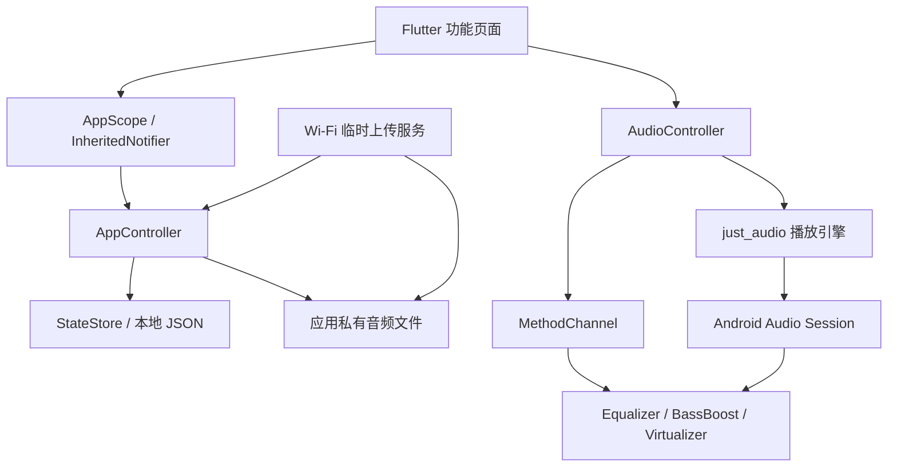

# Equali — Flutter 音乐播放器

根据 Pixso **Equali - Equalizer UI Kit / App Preview** 开发的 Flutter 应用。保留浅蓝色拟物界面、双向柔和阴影、紫色音效控件和唱片视觉，使用设计稿导出的头像、音乐封面与品牌标识。

应用以 Android 为主要验收平台。核心音乐功能离线可用；iOS 工程与 Web 预览入口也已提供。

## 界面预览

以下图片来自实际运行的 Android 模拟器，原始设计参考另存于 `docs/reference/`。

| 音乐首页 | 歌单详情 | 唱片播放器 |
| --- | --- | --- |
|  |  |  |

| 均衡器 | 虚拟环绕 | 登录界面 |
| --- | --- | --- |
|  |  |  |

完整页面、弹层和错误状态见 [截图目录](docs/SCREENSHOTS.md)。

## 已实现的功能

- **音乐浏览**：首页推荐、专辑歌曲列表、Today Hits、全部歌单和本地导入列表。
- **真实播放**：播放/暂停、上一首/下一首、波形区域拖动定位、单曲循环、随机播放和首页迷你播放器。
- **声音调节**：音量、五频段均衡器、6 个预设、自定义增益、低音增强、虚拟器与空间拓宽控制。
- **歌单管理**：新建、重命名、删除、添加歌曲、去重、移除歌曲、拖动排序；收藏与搜索历史保存在本地。
- **搜索**：按歌名/作者实时筛选、歌单内搜索、历史记录删除及无结果状态。
- **导入与传输**：系统文件选择器导入音频，MP4/MOV 音轨播放，Wi-Fi 网页上传；导入后复制到应用私有目录，单文件上限 40 MB。
- **个人资料**：资料编辑、表单校验、登录/注册/验证码/忘记密码/重置密码的本地演示流程。

### 功能范围

| 功能 | 实现方式与边界 |
| --- | --- |
| 音乐播放 | `just_audio` 真实解码，打包 3 段原创合成示例音频，每段 32 秒；12 条设计稿歌曲映射到这些示例，歌曲名称不代表随包提供商业录音。 |
| Android 音效 | Kotlin `MethodChannel` 接入 `Equalizer`、`BassBoost`、`Virtualizer`，仅作用于本应用播放会话；硬件不支持时展示能力提示。 |
| 3D Surround | 使用 Android Virtualizer 做耳机空间拓宽，与 Virtualizer 面板共用系统效果；并非独立的多声道或头部追踪引擎。 |
| 波形与唱片 | 波形是固定视觉示意，着色比例与真实播放进度同步；唱片与外圈使用 Flutter 绘制。 |
| Wi-Fi | 手机开启临时 HTTP 服务，电脑同网访问随机地址令牌上传；离开页面即关闭服务，不提供后台常驻传输。 |
| Dropbox | 使用系统文件提供器，需设备安装并启用 Dropbox；没有内置 Dropbox OAuth 或网盘 API。 |
| Video | 播放所选容器内可被系统解码的音轨；不生成单独的音频导出文件。 |
| 登录/注册 | 本地交互演示，不连接账号服务器，不存储密码、不发送邮件。验证码固定为 **1234**，界面有提示；社交登录显示接入说明。 |
| 分享 | 复制歌曲/歌单文本到剪贴板，不生成可公开访问的云端链接。 |
| 跨平台 | Android 完整主流程；iOS/Web 可播放与预览 UI，原生均衡器仅 Android，持久导入和 Wi-Fi 使用移动端实现。iOS 需在 macOS 上另外构建验收。 |

## 快速启动

开发环境：Flutter 3.47.7 / Dart 3.13.5。Android 最低 API 24，iOS 工程最低 14.0。

```sh
flutter pub get
flutter run -d emulator-5554
```

可先启动自己的 Android 模拟器，再使用 `flutter devices` 中的设备编号。

```sh
flutter run -d chrome
flutter build apk --release
```

Android 安装包输出到 `build/app/outputs/flutter-apk/`。当前工程使用开发签名，方便本地安装；商店发布前需要配置正式签名。

### 建议体验路径

1. 首页 → Good byes → Final Fantasy，进入播放器。
2. 点击四个效果入口，调整音量、预设和频段，试听差异。
3. 首页 → New Playlist，新建歌单并添加歌曲；右上角菜单可重命名和调整顺序。
4. Connect → Wifi Transfer，开始传输后在同一 Wi-Fi 的电脑浏览器打开手机给出的完整地址。
5. My Upload 查看导入的音频；头像进入资料和账号演示流程。

## 项目结构与架构

采用按功能划分的轻量结构。界面只负责呈现与输入，`AppController` 管理音乐库及持久化状态，`AudioController` 管理播放会话；无需额外的状态管理或路由依赖。

```text
EqualiEqualizer/
├─ lib/
│  ├─ main.dart                     # 应用入口、主题与生命周期保存
│  ├─ core/
│  │  ├─ app_controller.dart         # 歌单、资料、收藏、搜索历史；AppScope
│  │  ├─ audio_controller.dart       # 播放、队列、进度、设备音效能力
│  │  └─ wifi_transfer*.dart         # Wi-Fi HTTP 服务及平台适配
│  ├─ data/
│  │  ├─ models.dart                # Track / Playlist / SoundSettings
│  │  ├─ catalog.dart               # 设计稿音乐目录和初始歌单
│  │  ├─ local_store.dart           # 版本化 JSON / SharedPreferencesAsync
│  │  └─ media_files*.dart          # 导入音频的文件保存和平台适配
│  ├─ features/
│  │  ├─ library/                   # 首页、搜索、歌单、导入与传输
│  │  ├─ player/                    # 播放器、音效面板、自绘唱片和旋钮
│  │  └─ account/                   # 资料、登录、注册与找回密码演示
│  └─ ui/
│     ├─ theme.dart                 # 色彩、字体、全局主题
│     └─ widgets.dart               # 拟物容器、按钮、封面、输入框和弹层
├─ android/                         # Android 工程、原生音效桥接
├─ ios/                             # iOS 工程
├─ web/                             # Web 预览入口与品牌图标
├─ assets/
│  ├─ images/                       # Pixso 导出的可复用素材
│  ├─ fonts/                        # Open Sans 字体及 OFL 许可证
│  └─ audio/                        # 3 段离线合成示例音频
├─ test/                            # 状态、队列、存储、布局与 HTTP 传输测试
├─ integration_test/                # Android 用户流程和截图测试
├─ test_driver/                     # 截图写入本机目录
├─ tools/generate_assets.py         # 原创音频和应用图标再生成
└─ docs/
   ├─ ARCHITECTURE.md               # 模块依赖、数据流、平台与扩展说明
   ├─ SCREENSHOTS.md                # 全部运行截图索引
   ├─ TESTING.md                    # 验收环境、命令与结果
   ├─ screenshots/                  # 实际运行截图 PNG
   └─ reference/                    # Pixso 原始页面参考
```



更多说明见 [架构文档](docs/ARCHITECTURE.md) 与 [测试记录](docs/TESTING.md)。

## 测试与代码整理

验收结果：静态检查无问题，9 项自动化测试与 Android 集成流程通过；Release 安装启动检查和 Web 构建均通过。

```sh
flutter analyze
flutter test
flutter drive --driver=test_driver/screenshots.dart --target=integration_test/app_test.dart -d emulator-5554
```

截图测试使用测试模拟器运行，会写入示例歌单和资料，请勿在存有重要个人库的设备上执行。截图输出到 `docs/screenshots/`。

代码已移除 Flutter 计数器示例、无用依赖与模板注释；通用拟物组件、歌曲行、歌单弹层、账号表单和声音参数集中复用。原生音效对象随会话释放，Wi-Fi 服务随页面关闭，保存采用防抖及串行写入。

## 设计与素材

- 设计来源：用户当前打开的 Pixso 文件 `Equali - Equalizer UI Kit`，33 个 App Preview 画板，对应基础页面、弹层与表单状态。
- 图片与标识：从用户提供的 Pixso 图层导出，保留其原有使用权归属。
- 字体：[Open Sans / Google Fonts](https://github.com/google/fonts/tree/main/ofl/opensans)，许可证见 `assets/fonts/OFL.txt`。
- 音频与应用图标：本项目生成的原创演示素材，源程序见 `tools/generate_assets.py`。
- 播放和存储依赖：[just_audio](https://pub.dev/packages/just_audio)、[file_picker](https://pub.dev/packages/file_picker)、[shared_preferences](https://pub.dev/packages/shared_preferences)、[path_provider](https://pub.dev/packages/path_provider)。
